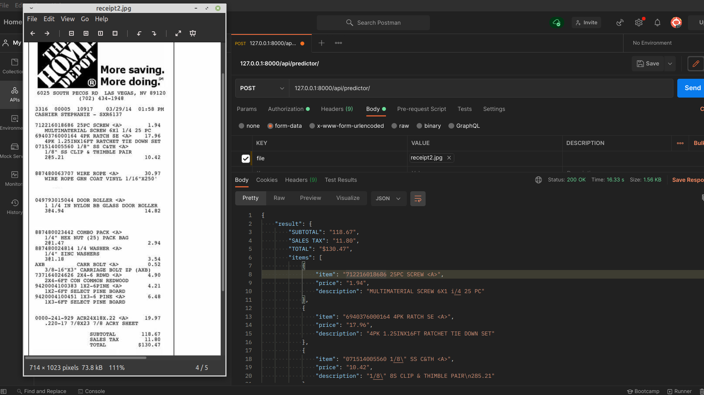

Proyecto OCR de Recibos


suba la imagen del recibo como `formdata` con la palabra clave `file`

recibirá el resultado analizado como una respuesta en json

# USO


## Paso 1. Instalar tesseract

### Instalar tesseract en Ubuntu

```sudo apt-get update
sudo apt-get install libleptonica-dev 
sudo apt-get install tesseract-ocr
sudo apt-get install libtesseract-dev
```
[Datos de entrenamiento para Tesseract](https://tesseract-ocr.github.io/tessdoc/Data-Files.html)


### Instalar tesseract en Windows

Para instalar Tesseract 4 en Windows, utilice este artículo informativo en MEDIUM:<br>
[Instalación y uso de Tesseract 4 en Windows 10](https://medium.com/quantrium-tech/installing-and-using-tesseract-4-on-windows-10-4f7930313f82)


### Paso 2. ```cd OCR_Receipt```
   
### Paso 3. ```pipenv install```

### Paso 4. ```pipenv shell```

### Paso 5. ```./src/manage.py migrate```

### Paso 6. ```./src/manage.py runserver```

### Paso 7. `endpoint`: "127.0.0.1:8000/api/predictor/"


# Ejemplo:




## PENDIENTE:

    - Crear un serializador mejor y más estricto.
    
    - Utilizar un modelo para guardar los resultados si es necesario.
